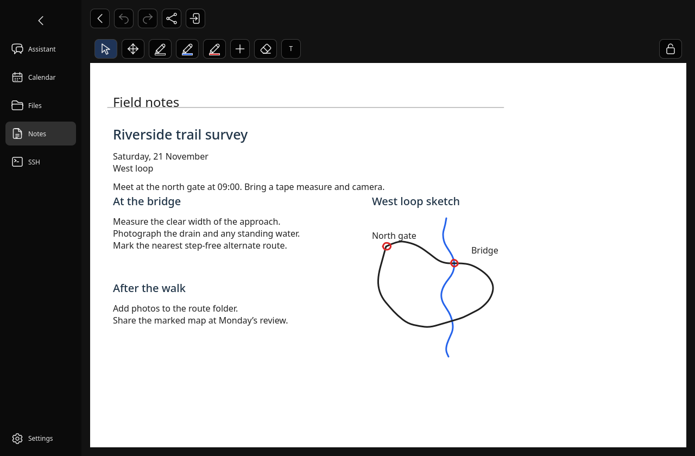

# Pilon

Pilon is a workspace you can extend with your own add-ons. Enable the features
you want, or build pages, settings and integrations in QML and JavaScript.
Package and share them as `.piext` files that install without rebuilding Pilon.

[](https://github.com/Lavarite/Pilon/actions/workflows/ci.yml)

## Install

On a compatible Linux x86_64 system:

```sh
curl -fsSL https://github.com/Lavarite/Pilon/releases/download/v1.0.0/install-linux.sh | sh
```

See [Linux requirements and manual installation](docs/install.md#linux) or
[install the Android ARM64 preview](docs/install.md#android).

## Create an add-on

Start with [Counter](examples/counter/readme.md) for a page and settings, or
[Checklist](examples/checklist/readme.md) for state that persists. Follow the
[add-on guide](docs/addons/index.md) to build your `.piext`, then import it from
**Settings → Add-ons**.

## Built-in add-ons

Notes and Calendar are two of the [built-in add-ons](docs/index.md#add-ons).




## Documentation

- [Installation and first run](docs/install.md)
- [Edit, export and import workspace configuration](docs/configuration.md)
- [Feature guides and add-ons](docs/index.md#add-ons)
- [Build from source and contribute](docs/CONTRIBUTING.md)
- [Report an issue](https://github.com/Lavarite/Pilon/issues)

Pilon is licensed under [GPL-3.0-only](LICENSE). Bundled components retain their
own notices.
