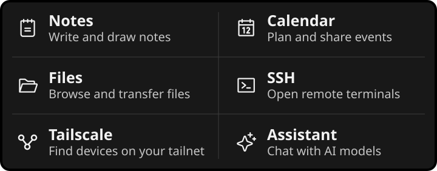

# 

Pilon is an open-source workspace for everyday work on Linux and Android.
Enable the add-ons you need or build your own.

[Install](#install) · [Add-ons](#built-in-add-ons) · [Build an add-on](#build-an-add-on) · [Documentation](docs/index.md)

## Trailer

https://github.com/user-attachments/assets/827b071c-0b3a-4cbf-9d68-6c40344704d6

## Install

**Linux x86‑64**

```sh
curl -fsSL https://pilon.vasylevskyi.net/download | sh
```

See [GitHub Releases](https://github.com/Lavarite/Pilon/releases) for platform downloads.
The [install guide](docs/install.md) covers Linux requirements and Android installation.

## Built-in add-ons



## Build an add-on

Describe what you need and give Codex, Claude Code, or OpenCode the
[add-on instructions](docs/addons/AGENTS.md). QML defines the interface.
JavaScript handles actions such as saving a checklist item.

Start from [Counter](examples/counter/readme.md) or
[Checklist](examples/checklist/readme.md). Import and enable the resulting
`.piext` in **Settings → Add-ons**.

[Contribute](CONTRIBUTING.md) · [Report a bug](https://github.com/Lavarite/Pilon/issues) · [GPL-3.0-only](LICENSE)

## Acknowledgements

Thanks to the maintainers of these projects.

- Interface icons from [Phosphor Icons](https://phosphoricons.com/).
- Application framework from [Qt](https://www.qt.io/).
- Assistant runtime built on [Codex](https://github.com/openai/codex).
- Local model inference with [llama.cpp](https://github.com/ggml-org/llama.cpp).
- Device discovery on a tailnet through [Tailscale](https://github.com/tailscale/tailscale).
- Office document conversion with [LibreOffice](https://www.libreoffice.org/).

[Full third-party notices](docs/third-party.md)
