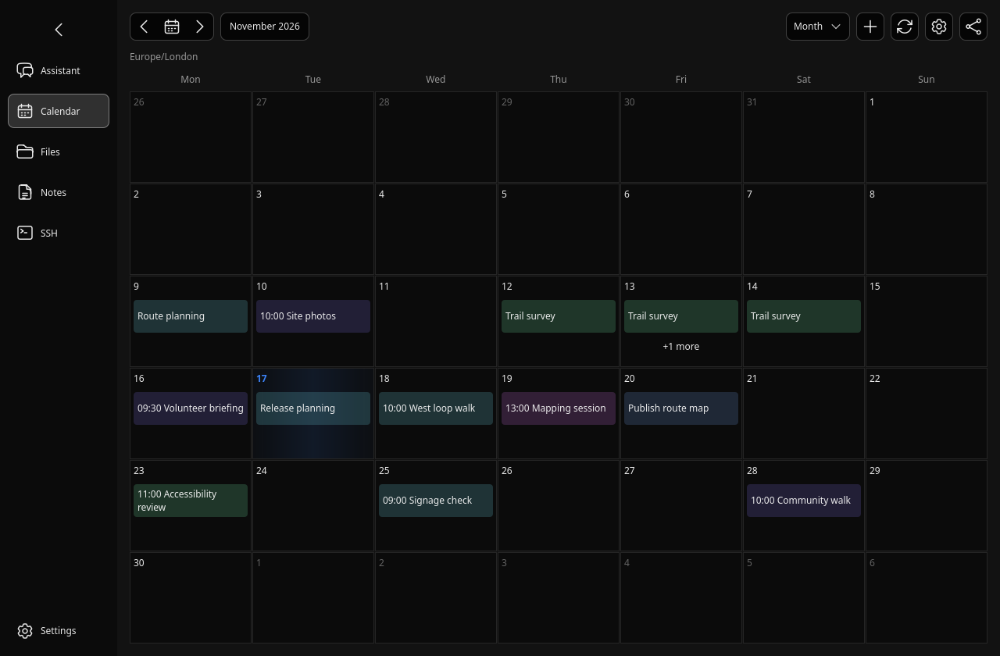
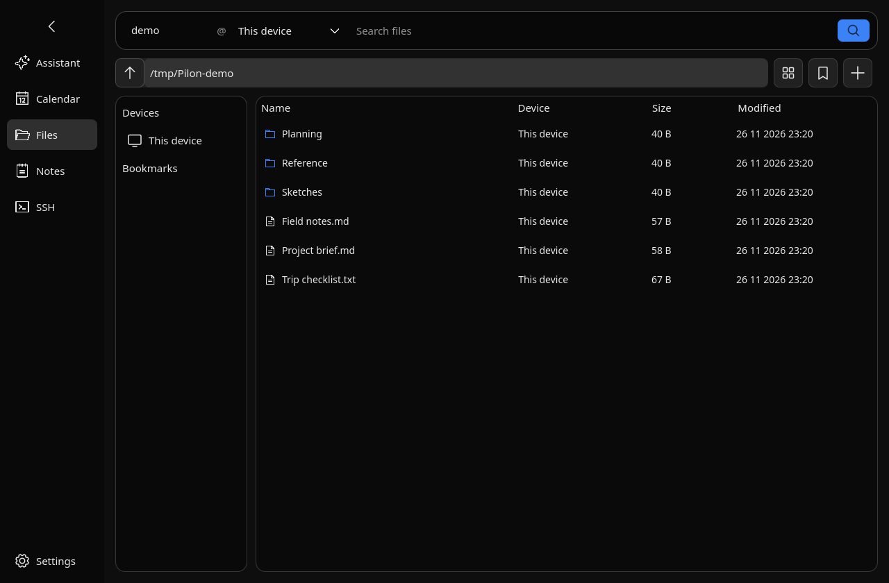
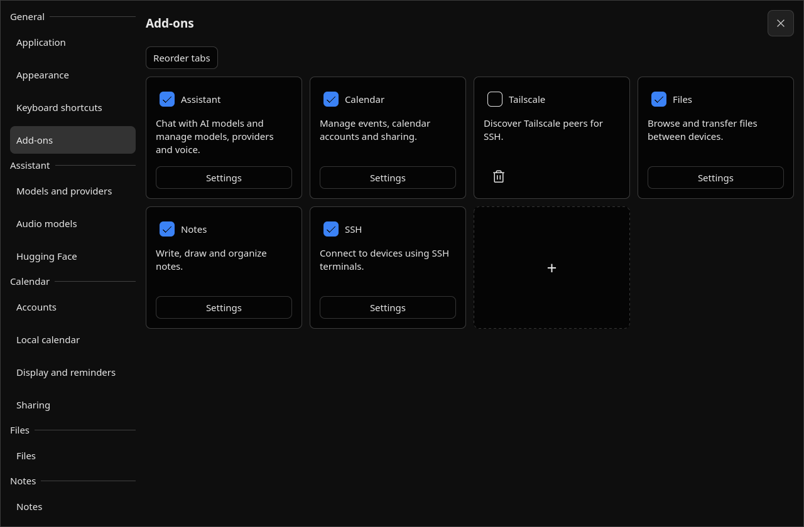

# 

Pilon is an open-source workspace for Linux and Android. Browse files, write
and draw notes, manage calendars, and connect over SSH. Extend it with your own
QML and JavaScript add-ons.

[Install](#install) · [Build an add-on](#build-an-add-on) · [Documentation](docs/index.md)

## Install

**Linux x86‑64**

```sh
curl -fsSL https://pilon.vasylevskyi.net/download | sh
```

See [GitHub Releases](https://github.com/Lavarite/Pilon/releases) for platform downloads.
The [install guide](docs/install.md) covers Linux requirements and Android installation.

## Build an add-on

Describe the tool you need and give a coding agent the
[add-on instructions](docs/addons/AGENTS.md). Start from
[Counter](examples/counter/readme.md) or [Checklist](examples/checklist/readme.md),
then import the resulting `.piext` in **Settings → Add-ons**.

## Screenshots

<table width="100%">
  <thead>
    <tr>
      <th width="50%" align="center">Notes</th>
      <th width="50%" align="center">Calendar</th>
    </tr>
  </thead>
  <tbody>
    <tr>
      <td width="50%" align="center" valign="top"></td>
      <td width="50%" align="center" valign="top"></td>
    </tr>
  </tbody>
</table>

<table width="100%">
  <thead>
    <tr>
      <th width="50%" align="center">Files</th>
      <th width="50%" align="center">Add-ons</th>
    </tr>
  </thead>
  <tbody>
    <tr>
      <td width="50%" align="center" valign="top"></td>
      <td width="50%" align="center" valign="top"></td>
    </tr>
  </tbody>
</table>

[Contribute](CONTRIBUTING.md) · [Report a bug](https://github.com/Lavarite/Pilon/issues) · [GPL-3.0-only](LICENSE)

## Acknowledgements

Thanks to the maintainers of these projects.

- Interface icons from [Phosphor Icons](https://phosphoricons.com/).
- Application framework from [Qt](https://www.qt.io/).
- Assistant runtime built on [Codex](https://github.com/openai/codex).
- Local model inference with [llama.cpp](https://github.com/ggml-org/llama.cpp).
- Device discovery on a tailnet through [Tailscale](https://github.com/tailscale/tailscale).
- Office document conversion with [LibreOffice](https://www.libreoffice.org/).

[Full third-party notices](docs/third-party.md)
